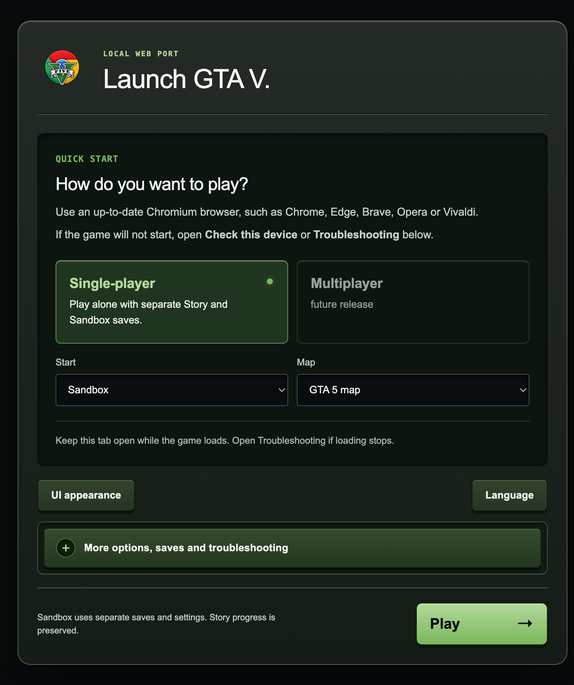
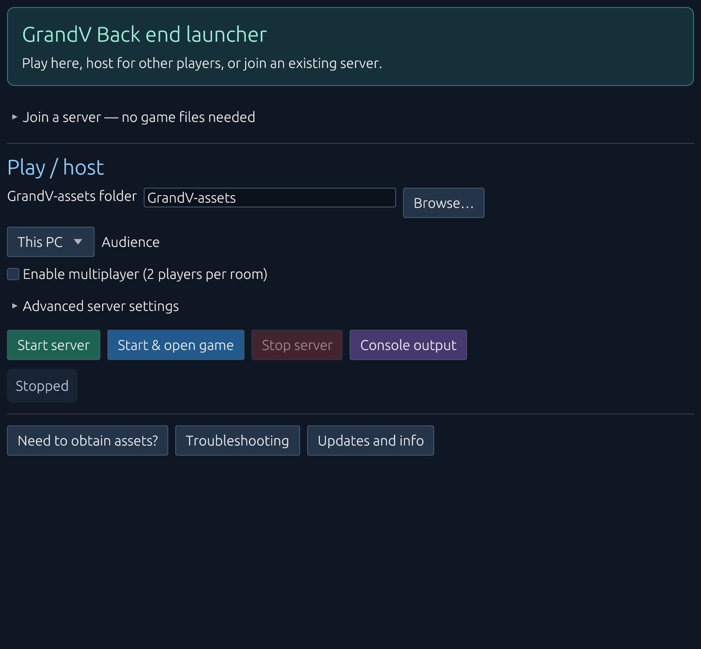

# Grand-V, but clean

## [Download the launcher](https://github.com/waste-mgmt-consultant/Grand-V-but-clean/releases/latest) for Windows, macOS or Linux

No memecoin shit. Just the game.

A fork of [SebasKitten/Grand-V](https://gitlab.com/SebasKitten/Grand-V) without the coin and donation parts:

- The launcher has no donation window and no wallet list.
- The app name has no `$` ticker.
- The launcher removes the Donate, Tweet and Trade `$GrandV` buttons and the donation dialog from the web UI when it serves the pages. The game asset files stay unchanged.

The launcher also fixes known game crashes and can check the game files for damage. See [Game fixes](#game-fixes) and [Check game files](#check-game-files).

**[Download the launcher from Releases](https://github.com/waste-mgmt-consultant/Grand-V-but-clean/releases)** for Windows, macOS or Linux. GitHub Actions builds it from this repo. You can also [build it yourself](LauncherApp/rust/README.md#build-and-test). The game assets are separate.

- macOS: the app is not notarized. After you unzip it, run `xattr -dr com.apple.quarantine "GrandV back-end host.app"`, or allow it in System Settings → Privacy & Security.
- Windows: SmartScreen can warn about the unsigned exe. Click More info → Run anyway.

## Quick start

1. Put the launcher next to your `GrandV-assets` folder, or click **Browse…** in the launcher and select that folder.
2. Under **Audience**, choose who can play: **This PC**, **LAN / school network** or **Public website**.
3. Click **Start & open game**.

The [launcher guide](LauncherApp/rust/README.md) covers LAN and public hosting, multiplayer and command-line options.

## About Grand-V

Grand-V is a browser-based port of GTA V built on a reverse-engineered RAGE engine, converted to WebAssembly memory64 with shared-memory workers and WebGPU. The project builds on [rea](https://github.com/morluto/rea).

## Features

- Web launcher with Story and Sandbox modes
- Separate saves per mode
- Graphics settings and controller / touch controls
- Experimental multiplayer support
- Frame rate limits: 24, 30, and 60 FPS and experimental 120 FPS.

 

## Game fixes

Set these under **Game fixes** before you start the server. Your game files stay unchanged; the launcher serves fixed copies.

- **Limit the game's streaming memory** (on by default): stops the "Invalid fixup" crash after long play. The default limit is 1.5 GB.
- **Cash hotkey in Story mode** (off by default): each press of the key right of 0 adds $999,999.
- **Snapmatic photos** (always on): taking a photo with the phone camera no longer stops the game, and the photo is no longer black.
- **Photos as JPG files** (always on, **This PC** only): each photo you save to the phone gallery, in Story or Sandbox, is also saved as `GrandV-assets/photos/PGTA5<number>.jpg`. The file stays when you delete the photo in the game. The game does not keep Sandbox files, so after a page reload the Sandbox gallery is empty again. The JPG file stays.

Used the old `cash_hotkey.py` script? Delete the `GrandV-assets/overrides/` folder, or the old hotkey stays on.

The same settings are in `launcher-settings.json`: `memory_limit`, `memory_limit_heaps` (1–31, × 256 MB) and `cash_hotkey`.

## Check game files

Use this if the game stops with "zstd error Data corruption detected" or keeps crashing in the same area. The usual cause is a torrent download that did not finish.

1. Click **Check game files**, then **Start check**. It takes about a minute on a fast disk and changes nothing.
2. If it finds damage, force a recheck in your torrent client (qBittorrent: right-click, **Force recheck**) and let it reach 100%.
3. Run the check again, then reload the game page.
4. Still crashing in the same area? Open **More options, saves and troubleshooting**, then **Clear game cache**. Your saves and settings stay.

The check skips some archives (mostly audio) and loose files. A torrent recheck covers every file. To run the check without the window, see [Command line](LauncherApp/rust/README.md#command-line).

## System Requirements

### Desktop (Primary Target)

| Component       | Minimum                          | Recommended                      |
|-----------------|----------------------------------|----------------------------------|
| CPU         | Modern 4-core processor          | —                                |
| RAM         | 8 GB (low-memory mode)           | 16 GB or more                    |
| Graphics    | WebGPU-compatible integrated or dedicated GPU with current drivers and browser hardware acceleration enabled | — |
| Browser     | Up-to-date Chrome, Edge, or compatible Chromium browser with shared WebAssembly memory64 support | — |
| OS          | Windows, macOS, or Linux         | Windows (most tested)            |

Compatibility on macOS and Linux depends on GPU, drivers, and browser support.

### Mobile

Android and iOS support is experimental. Browser feature availability, memory constraints, and mobile GPU compatibility remain limiting factors.

## Hosting & Setup

The project is designed to be as simple as possible to run.

- Local self-hosting — No certificate required.
- LAN or website hosting — The launcher manages server startup, graphics options, and LAN configuration.
- LAN HTTPS clients must install and trust the certificate generated by the launcher. This is not required when hosting as a standard HTTPS website.

Client devices only need to open the host’s URL in a compatible browser. No separate game installation is required on each client.

Behind a reverse proxy on another machine, or in a container, set the listen address. See [Listen address](LauncherApp/rust/README.md#listen-address).

## Current Development Focus

Active work is ongoing in the following areas:

- Stability
- Rendering
- Audio
- Streaming
- Compatibility

## Reporting issues

Report game bugs [upstream](https://gitlab.com/SebasKitten/Grand-V/-/issues) with your device model, OS/browser versions, the type of bug, and steps to reproduce it.

Report problems with this fork [here](https://github.com/waste-mgmt-consultant/Grand-V-but-clean/issues): the launcher downloads, the coin removal, the game fixes and the game file check.

Not sure where a crash belongs? First run **Check game files** and repair any damage. Then try again with the **Game fixes** turned off. If the crash goes away, report it here.

## Disclaimer & Copyright

This project is provided for educational purposes only.  

We do not supply, distribute, or host any game data, mirror files, or proprietary assets belonging to Rockstar Games or Take-Two Interactive. Users are solely responsible for obtaining any required game files through legitimate means.

Grand Theft Auto V and all related trademarks, assets, and intellectual property are the property of their respective owners. This project is not affiliated with, endorsed by, or connected to Rockstar Games or Take-Two Interactive in any way.

## Community

Grand-V is created and maintained by SebasKitten. This fork is maintained separately.

Join the project channels to follow progress:

- Telegram: [https://t.me/reGRANDTA](https://t.me/reGRANDTA)
- Discord: [https://discord.gg/hrbcPjjZfj](https://discord.gg/hrbcPjjZfj)
- X: [@Sebas_Kitten](https://x.com/Sebas_Kitten)
